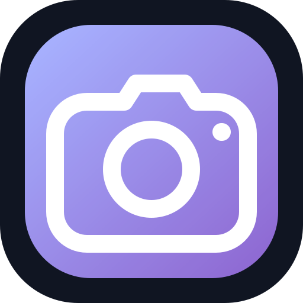
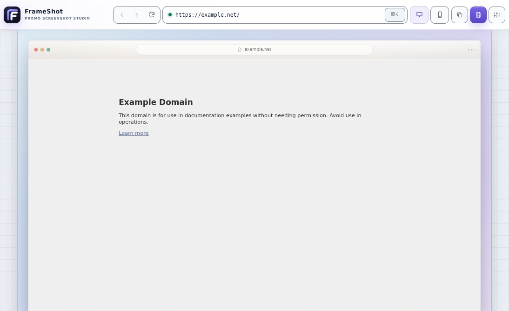

  

<h1 align="center">FrameShot</h1>

  Webページを操作しながら、背景やデバイスフレーム付きのPNGを作れるWindowsアプリです。

  

## ダウンロード

[Latest Release](https://github.com/jyuzen-sw/frameshot-electron/releases/latest)から、`FrameShot-<version>-Windows-x64-Portable.exe`をダウンロードしてそのまま起動できます。インストールは不要です。

現在の対応環境はWindows x64です。アプリは未署名のため、ダウンロード時や初回起動時にMicrosoft Defender SmartScreenの警告が表示される場合があります。

## こんなことができます

- URLを開き、スクロールやログイン後の画面をそのまま撮影
- Desktop、Android、iPhone、iPad向けのサイズへすばやく切り替え
- ブラウザや端末のフレーム、余白、影、淡い背景を組み合わせる
- 仕上がりをPNGとして保存、またはクリップボードへコピー
- OAuthポップアップや開発用HTTPSにも対応

## 使い方

1. 上部のURL欄へ撮影したいページを入力します。
2. 中央のページを操作して、撮りたい状態を作ります。
3. Desktop / Phoneプリセットや設定パネルから見た目を整えます。
4. 「保存」または「コピー」を押せば完成です。

### Desktopプリセット

| プリセット | 出力サイズ |
|---|---:|
| HD | 1280 × 720 |
| WXGA | 1280 × 800 |
| FWXGA | 1366 × 768 |
| WXGA+ | 1440 × 900 |
| FHD | 1920 × 1080 |
| WQHD | 2560 × 1440 |
| UWQHD | 3440 × 1440 |
| 4K UHD | 3840 × 2160 |

既定値はFHDです。プリセットにないサイズはCustomから指定できます。Phoneでは代表的なAndroid、iPhone、iPadのサイズを選べます。

### キーボード

| 操作 | キー |
|---|---|
| URL欄へ移動 | `Ctrl/Cmd + L` |
| PNG保存 | `Ctrl/Cmd + S` |
| ページを再読み込み | `Ctrl/Cmd + R` |

## 利用前に知っておきたいこと

### クリップボード

画像のコピーはネイティブWindows版で利用できます。WSL2 / WSLgでは「保存」を使ってPNGを書き出してください。

### セッションとOAuth

ログイン情報はアプリを開いている間だけ保持し、終了時に破棄します。OAuthポップアップを開く前には、移動先URLを確認するダイアログを表示します。

### 証明書エラーの例外

開発用HTTPSでは、証明書エラーをホスト単位で許可できます。期限切れやホスト名不一致を含むすべての検証エラーが対象になるため、信頼できる開発環境だけで使ってください。

### セキュリティ

FrameShotは、自分で管理しているサイトや信頼できるサイトの撮影を想定しています。撮影するページはアプリの操作画面から分離して開き、カメラやマイクなどの権限とファイルダウンロードを拒否します。画像がアプリの外へ出るのは、保存またはコピーを選んだときだけです。

## 開発したい方へ

セットアップやテスト、ビルド、リリースについては[`DEVELOPMENT.md`](DEVELOPMENT.md)、詳しい設計については[`docs/ARCHITECTURE.md`](docs/ARCHITECTURE.md)をご覧ください。

## ライセンス

MIT
